# Awesome-Developer-Tools

  

  
  
  
  
  
  
  

  <strong>Curated Directory of World-Class Developer Tools, Enterprise SaaS Platforms & High-Star Open-Source Repositories</strong> 
  <em>Supercharging software engineering with API design, internal tool builders, low-code platforms, and AI pair-programming agents.</em>

---

## 📑 Table of Contents

- [🌐 Sector Overview & Market Dynamics](#-sector-overview--market-dynamics)
- [💼 SaaS & Hosted Platforms](#-saas--hosted-platforms)
- [🔓 Open-Source GitHub Projects](#-open-source-github-projects)
- [🤝 How to Contribute](#-how-to-contribute)
- [💖 Support & Sponsorship](#-support--sponsorship)
- [📈 Star History](#-star-history)
- [⚖️ Disclaimer](#️-disclaimer)

---

## 🌐 Sector Overview & Market Dynamics

The global developer tools software ecosystem is projected at **$7.4 billion to $8.8 billion** in 2026 for core engineering toolchains (code editors, IDEs, API clients, testing suites, CI/CD pipelines), surging past **$250 billion+** when encompassing the broader enterprise application modernization and low-code development ecosystem.

The market follows a **bimodal, moderately concentrated landscape**: foundational distribution anchors (source code repositories, cloud DevOps pipelines, and core IDEs) demonstrate winner-take-most dominance spearheaded by hyperscalers and tech giants like Microsoft, while specialized sub-verticals (API lifecycle testing, visual low-code/internal builders, and autonomous AI coding agents) stay intensely innovative, fragmented, and contested with thriving open-source alternatives.

---

## 💼 SaaS & Hosted Platforms

| Platform | Category / Focus | Company Scale (Valuation / Revenue) | Pricing (Starting Paid Tier) | Free Tier / Trial Limits | Best For |
| :--- | :--- | :--- | :--- | :--- | :--- |
| **[Visual Studio Code](https://code.visualstudio.com/)** | Code Editor & Ecosystem | **~$3.90T+ Market Cap** *(Parent: Microsoft; FY25 Rev: $245B+)* | **$0 / month** (Commercial use 100% free; optional Visual Studio Pro IDE at $45/mo or $1,199/yr) | **Free forever**: Full desktop code editor, unlimited local extensions, and commercial usage with no seat cap | Developers seeking an ultra-extensible, lightweight code editor with ecosystem support |
| **[GitHub Enterprise](https://github.com/enterprise)** | DevOps & Enterprise Repo Hosting | **~$3.90T+ Market Cap** *(Parent: Microsoft; GitHub ARR >$2B)* | **$21 / user / month** (billed annually at $252/user/yr) | **30-day free trial**: Up to 50 user seats, including Cloud, GHES, and evaluation security features | Organizations wanting end-to-end DevOps integrated with the premier open-source ecosystem |
| **[Mendix Studio Pro](https://www.mendix.com/)** | Enterprise Low-Code Platform | **~$205B Market Cap** *(Parent: Siemens AG; Acquired for $680M)* | **$50 / user / month** (Basic tier; Standard single-app at ~$900/mo) | **Free forever**: 1 personal cloud environment, 0.5 GiB database, 1 GiB storage, 0.5 vCPU; sleeps after 1h inactivity | Teams building collaborative low-code web and mobile solutions with industrial-grade governance |
| **[Workday Extend](https://www.workday.com/)** | Enterprise Low-Code Extensions | **~$54B Market Cap** *(FY25 Revenue: $8.45B)* | **~$30,000 / year** (Starting annual contract add-on for Extend Essentials) | **No self-serve free tier or trial**: Sandbox access is provisioned strictly via contracted enterprise packages or the Workday Build partner program | Workday customers building custom apps, approval workflows, and data extensions on core Workday data |
| **[GitLab](https://about.gitlab.com/)** | Complete DevOps Platform | **~$9.3B Market Cap** *(FY25 Revenue: $759.2M)* | **$29 / user / month** (Premium plan, annual billing) | **Free forever**: Up to 5 users per namespace, 5 GB storage, 10 GB transfer/month, and 400 CI/CD compute minutes/month | Teams wanting an integrated DevOps platform with native CI/CD, compliance, and security |
| **[OutSystems Developer Studio](https://www.outsystems.com/)** | High-Performance Low-Code | **$4.3B Valuation** *(2022 funding; ~$300M+ ARR)* | **~$36,300 / year** (Entry-level enterprise subscription, custom quoted) | **Free forever**: 1 shared personal cloud environment, 1–2 GB database storage, non-production single environment, no SLA | Enterprises seeking governed, full-stack application development for complex portfolio systems |
| **[Postman](https://www.postman.com/)** | API Lifecycle & Collaboration | **$5.6B Valuation** *(ARR: ~$313M+)* | **$19 / user / month** (Team tier, billed annually; or $9/mo Solo tier) | **Free forever**: 1 user seat, unlimited collection runs, unlimited mock servers, up to 10,000 Postman API calls/mo, and 5 integrations | Teams and solo developers needing an industry-standard API client and testing platform |
| **[SwaggerHub](https://swagger.io/tools/swaggerhub/)** | API Design & Documentation | **~$3.0B Valuation** *(SmartBear; Revenue: ~$400M–$500M)* | **$19 / user / month** (Designer/Pro tier, billed annually) | **Free forever**: 1 user seat, limited to public APIs (or up to 2 private API definitions), with read-only enforcement on overages | Teams wanting centralized OpenAPI standard compliance, design governance, and documentation |
| **[Retool](https://retool.com/)** | Internal Tools Builder | **$1.85B Valuation** *(Private tech unicorn; ARR ~$50M–$100M+)* | **$10 / builder / month** + $5 / user / month (Team plan, billed annually) | **Free forever**: Up to 5 total users, unlimited web/mobile apps, 500 workflow runs/mo, 5 GB storage, and 250 AI credits/mo | Developers building internal portals, database GUIs, and operational dashboards quickly |
| **[JetBrains](https://www.jetbrains.com/)** | Specialized Professional IDEs | **~$710M Annual Revenue** *(Bootstrapped; estimated $3B–$5B valuation)* | **$8.90 / user / month** (Single language IDEs; All Products Pack at $28.90/user/mo billed annually) | **Free forever**: Community Editions (IntelliJ IDEA & PyCharm) are open-source and free without time limits; 30-day full-feature trial for paid commercial IDEs | Engineers needing language-specialized IDEs with deep semantic analysis, refactoring, and debugging |

---

## 🔓 Open-Source GitHub Projects

Curated list of leading open-source developer tools, sorted in **descending order by GitHub Stars_Count**.

- **[Supabase](https://github.com/supabase/supabase)** 
  - **The open-source Firebase alternative** (Apache 2.0) — Complete Postgres development platform providing instant auto-generated REST/GraphQL APIs, real-time subscriptions, authentication, storage, and serverless Edge Functions.
  - **Features**: Native PostgreSQL at core, instantaneous schema migration tools, database web studio, Row Level Security (RLS), and vector search support for AI embeddings.
  - **Tech stack**: TypeScript, Elixir, Go, PostgreSQL.
  - **Deploy**: Self-hosted (Docker, Kubernetes) or Supabase Cloud.
  - **Best for**: Developers wanting a scalable, enterprise backend-as-a-service with complete database freedom and zero vendor lock-in.

- **[Hoppscotch](https://github.com/hoppscotch/hoppscotch)** 
  - **Open-source API development ecosystem** (MIT) — The premier web-based, offline-first alternative to Postman.
  - **Features**: Full support for REST, GraphQL, WebSocket, SSE, Socket.IO, and MQTT; team collaboration spaces; environment variables; and automated test scripts.
  - **Tech stack**: Vue.js, TypeScript.
  - **Deploy**: Self-hosted via Docker or instant hosted web application.
  - **Best for**: Teams seeking a lightweight, clean, fast API exploration environment with zero mandatory login.

- **[Cline](https://github.com/cline/cline)** 
  - **Autonomous open-source AI coding agent** (Apache 2.0) — High-velocity AI development assistant directly integrated into VS Code with millions of installs.
  - **Features**: Human-in-the-loop permission approvals for file modifications and terminal commands, Model Context Protocol (MCP) tool support, multi-file code editing, and connectivity with custom models (Anthropic, OpenAI, AWS Bedrock, GCP Vertex AI, Ollama).
  - **Tech stack**: TypeScript.
  - **Deploy**: VS Code Extension.
  - **Best for**: Engineers wanting a deeply integrated AI pair programmer with strict execution guardrails and complete auditable source transparency.

- **[NocoDB](https://github.com/nocodb/nocodb)** 
  - **Open-source smart spreadsheet & low-code database** (AGPL-3.0) — The leading self-hosted Airtable alternative that turns any relational database into an interactive smart database spreadsheet.
  - **Features**: Connects directly to PostgreSQL, MySQL, SQL Server, and SQLite; generates collaborative Grid, Kanban, Gallery, and Form views; provides automated REST/GraphQL APIs and webhook integrations.
  - **Tech stack**: Vue.js, Node.js, TypeScript.
  - **Deploy**: Docker, NPM, Kubernetes.
  - **Best for**: Teams seeking a user-friendly low-code data browser and administrative panel directly connected to production relational databases.

- **[Aider](https://github.com/Aider-AI/aider)** 
  - **AI pair programming in your terminal** (Apache 2.0) — The benchmark terminal-based autonomous coding tool.
  - **Features**: Automatically maps repository code architecture, edits complex multi-file codebases, stages and writes clean atomic Git commit messages for every change, and supports frontier LLMs alongside local models.
  - **Tech stack**: Python.
  - **Deploy**: CLI (`pip install aider-chat`).
  - **Best for**: Terminal-focused developers seeking fast, transparent AI assistance with rigorous version control hygiene.

- **[Bruno](https://github.com/usebruno/bruno)** 
  - **Local-first, Git-friendly open-source API client** (MIT) — A fast, modern Postman alternative that stores collections as plain text files (`.bru`) directly in your code repository.
  - **Features**: Plain file-based storage enabling seamless Git collaboration, REST and GraphQL support, local test scripting, and zero cloud sync or external servers.
  - **Tech stack**: Electron, React.
  - **Deploy**: Native desktop application (macOS, Windows, Linux) and CLI runner.
  - **Best for**: Teams desiring developer-friendly API collections versioned right beside application source code.

- **[ToolJet](https://github.com/ToolJet/ToolJet)** 
  - **Open-source low-code internal tool builder** (AGPL-3.0) — Enterprise-grade alternative to Retool for assembling internal applications, admin consoles, and workflows.
  - **Features**: Drag-and-drop canvas with 50+ pre-built UI components, built-in database (ToolJet DB), granular RBAC, and 50+ data connectors (PostgreSQL, MongoDB, Stripe, Google Sheets, Slack).
  - **Tech stack**: React, NestJS, TypeScript.
  - **Deploy**: Docker, Helm, AWS EC2, Kubernetes.
  - **Best for**: Engineering teams looking to replace custom admin panel development with a self-hosted low-code portal.

- **[Appsmith](https://github.com/appsmithorg/appsmith)** 
  - **Low-code application platform for developer productivity** (Apache 2.0) — Robust platform to rapidly build administrative panels, dashboards, and internal operational portals.
  - **Features**: Visual drag-and-drop designer, JavaScript anywhere for data transformation, real-time collaborative editing, audit logs, and SSO integration.
  - **Tech stack**: React, Java, TypeScript.
  - **Deploy**: Docker, Helm, Kubernetes.
  - **Best for**: Developers wanting a mature, reliable internal tools platform with native JavaScript flexibility.

- **[HTTPie CLI](https://github.com/httpie/cli)** 
  - **Human-friendly CLI HTTP client for the modern web** (BSD-3-Clause) — Intuitive command-line HTTP utility designed for seamless API testing and debugging.
  - **Features**: Expressive syntax, built-in JSON support with syntax highlighting, persistent sessions, formatted terminal output, and file download resuming.
  - **Tech stack**: Python.
  - **Deploy**: Package managers (`brew`, `apt`, `pacman`, `pip`).
  - **Best for**: Terminal enthusiasts who want a user-friendly, human-readable replacement for curl when interacting with REST APIs.

- **[Directus](https://github.com/directus/directus)** 
  - **Open Data Platform & Backend-as-a-Service** (BSL-1.1 / GPL-3.0) — Instant REST & GraphQL API generation and intuitive admin data management layered over SQL databases.
  - **Features**: Non-destructive SQL reflection, real-time WebSocket events, built-in visual workflow automations, file storage asset management, and modular extensibility.
  - **Tech stack**: Vue.js, Node.js, TypeScript.
  - **Deploy**: Docker, NPM, Cloud.
  - **Best for**: Developers creating data-rich web applications, headless CMS architectures, and custom database backends.

- **[Tabby](https://github.com/TabbyML/tabby)** 
  - **Self-hosted AI coding assistant** (Apache 2.0) — Open-source, private alternative to GitHub Copilot.
  - **Features**: On-premises inference with consumer GPUs, multi-language code completion and repository context retrieval, IDE extensions for VS Code and JetBrains, and strict privacy guarantees.
  - **Tech stack**: Rust, TypeScript.
  - **Deploy**: Docker, Kubernetes.
  - **Best for**: Security-conscious organizations that require fully air-gapped, self-hosted AI code autocompletion.

- **[Swagger UI](https://github.com/swagger-api/swagger-ui)** 
  - **Interactive API documentation from OpenAPI specifications** (Apache 2.0) — The web standard for visualizing and testing RESTful APIs defined in OpenAPI (OAS).
  - **Features**: Interactive "Try It Out" API sandboxes, automatic JSON/YAML schema parsing, client SDK code snippet rendering, and universal framework support.
  - **Tech stack**: React, JavaScript.
  - **Deploy**: CDN, Docker, npm package.
  - **Best for**: Platform and backend developers building developer-facing interactive API documentation.

- **[Redoc](https://github.com/redocly/redoc)** 
  - **Open-source OpenAPI/Swagger reference documentation generator** (MIT) — Elegant, responsive three-panel API documentation.
  - **Features**: Instant rendering of OpenAPI 3.0/3.1 specs, code samples in multiple languages, responsive search, markdown descriptions, and clean static HTML compilation.
  - **Tech stack**: React, TypeScript.
  - **Deploy**: Web component, npm, Docker.
  - **Best for**: Teams seeking beautiful, enterprise-grade, read-only developer portal documentation.

- **[Windmill](https://github.com/windmill-labs/windmill)** 
  - **Developer platform to turn scripts into workflows and UIs** (AGPL-3.0) — Ultra-fast alternative to Retool and Airflow.
  - **Features**: Write scripts in Python, TypeScript, Go, Bash, or SQL; auto-generate UIs; workflow DAG orchestrations; schedules; and horizontal worker autoscaling.
  - **Tech stack**: Rust, Svelte, PostgreSQL.
  - **Deploy**: Docker, Kubernetes, or Windmill Cloud.
  - **Best for**: DevOps, platform teams, and backend engineers seeking high-performance workflow automations without bloated boilerplate.

- **[Scalar](https://github.com/scalar/scalar)** 
  - **Modern interactive API documentation & client** (MIT) — Next-generation developer documentation built specifically for OpenAPI/Swagger.
  - **Features**: Integrated API client to test requests immediately, modern aesthetic UI, themeable design system, offline capability, and instant static site generation.
  - **Tech stack**: Vue.js, TypeScript.
  - **Deploy**: CDN, npm package, framework integrations (FastAPI, Express, Elysia, NestJS).
  - **Best for**: Modern development teams wanting interactive, lightning-fast API reference documentation.

- **[Lowcoder](https://github.com/lowcoder-org/lowcoder)** 
  - **Open-source low-code platform for internal and client-facing apps** (AGPL-3.0) — Direct visual alternative to Retool and Appsmith.
  - **Features**: 120+ pre-built UI components, native embedding into host applications without iframes, extensive database/API connector collection, and granular access permissions.
  - **Tech stack**: TypeScript, React, Node.js.
  - **Deploy**: Self-hosted (Docker) or Lowcoder Cloud.
  - **Best for**: Developers building customer-facing application portals and embedding internal tools directly into existing web apps.

- **[Sourcey](https://github.com/sourcey/sourcey)** 
  - **Modern documentation engine for APIs and AI agents** (AGPL-3.0) — Self-hosted documentation suite with deep support for modern agentic patterns.
  - **Features**: OpenAPI 2.0–3.2 support, automatic code samples in 10 languages, native Model Context Protocol (MCP) server documentation, and `llms.txt` generation for AI systems.
  - **Tech stack**: TypeScript, Vite.
  - **Deploy**: Static HTML deployment (Vercel, Cloudflare Pages, S3).
  - **Best for**: API architects needing cutting-edge developer documentation tailored for human engineers and AI coding agents.

- **[Resonance](https://github.com/letsfork/resonance)** 
  - **Local-first, zero-account open-source API client** (MIT) — Ultra-lightweight desktop alternative to Postman built with Tauri and Rust.
  - **Features**: ~15 MB memory-efficient binary, multi-protocol execution (REST, GraphQL, gRPC, WebSocket, SSE, MQTT), OS keychain secret storage, mock server, and collection runner.
  - **Tech stack**: Tauri, Rust, TypeScript.
  - **Deploy**: Desktop application (macOS, Windows, Linux).
  - **Best for**: Developers wanting a minimal, high-speed, privacy-first API workstation with zero account dependencies.

---

## 🤝 How to Contribute

Contributions are warmly welcome! Help make this curated repository even more useful for engineers around the world.

1. 🍴 **Fork the repository** on GitHub.
2. 🌿 **Create a new branch** (`git checkout -b feature/awesome-tool`).
3. 📝 **Add your entry** in `README.md` following the existing format:
   - Tool Name, Link, GitHub Stars_Badge (if open-source), License, Description, Tech Stack, and Best-For recommendation.
4. 🧪 **Check link formatting & badges** to ensure everything renders smoothly.
5. 🚀 **Submit a Pull Request** with a concise summary of the addition!

---

## 💖 Support & Sponsorship

If this curated list saved you time, discovered your next favorite developer tool, or helped optimize your engineering stack, please consider showing your support:

- 🌟 **Star this repository** to help other developers find it.
- 🍴 **Fork and contribute** new open-source projects or SaaS platforms.
- 📢 **Share it** on X / Twitter, LinkedIn, Reddit, or your engineering team's Slack/Discord.
- ☕ **Sponsor or buy a coffee**: Support ongoing curation and maintenance via the **[GitHub Sponsors Dashboard](https://github.com/sponsors/ishandutta2007)**!

Thank you to all community contributors, builders, and stargazers! 🙌

---

## 📈 Star History

---

## ⚖️ Disclaimer

- This is a **community-curated index** for informational purposes — not an endorsement of any particular tool or company.
- Developer tools handling source code and API data must comply with data protection regulations (GDPR, CCPA, SOC 2, HIPAA) and enforce proper access controls for proprietary codebases.
- **SaaS vs. Self-Hosted vs. AI Agents**:
  - **Postman, GitHub Enterprise, GitLab, OutSystems, Mendix, Retool, SwaggerHub, and Workday Extend** are enterprise managed SaaS platforms.
  - **Supabase, Hoppscotch, Bruno, NocoDB, ToolJet, Appsmith, Windmill, Lowcoder, Scalar, Swagger UI, Redoc, Sourcey, and Resonance** provide full self-hosting freedom.
  - **Cline, Aider, and Tabby** are specialized AI coding assistants. Choose according to your team's compliance, deployment model, and governance policies.
- Pricing, tiers, and limits change frequently. Verify current terms directly with vendor pricing pages before enterprise procurement.

---

  <strong>Crafted with ❤️ for developers, platform engineers, and open-source architects worldwide.</strong> 
  Let's keep developer tooling transparent, open, and community-driven.

